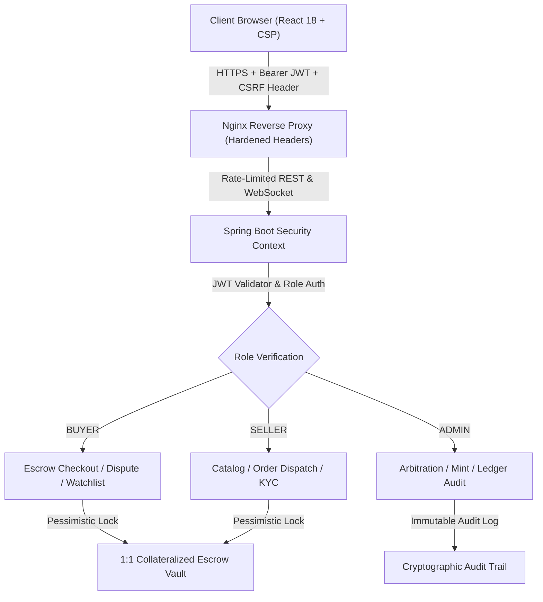
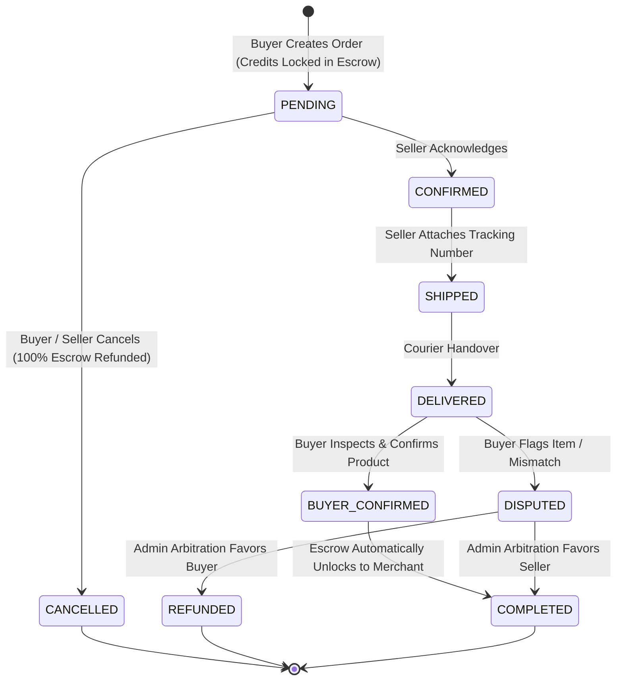

# Nexora Platform Security Architecture & Compliance Policy

## 1. Security Architecture Overview
Nexora is designed around a **Zero-Trust Defense-in-Depth** architecture. All peer-to-peer commerce and credit transactions are strictly governed by an automated escrow state machine, role-based access control (RBAC), and multi-layered client/server security safeguards.



---

## 2. Threat Modeling & OWASP Top 10 Mitigations

| Vulnerability Category | Nexora Defense Mechanism | Implementation Details |
|---|---|---|
| **A01: Broken Access Control** | Declarative Route Guards + Backend RBAC | `ProtectedRoute.jsx` checks role tokens on client routes; Spring Boot `@PreAuthorize("hasRole(...)")` enforces strict boundary. Users cannot access or manipulate other users' orders or wallets. |
| **A02: Cryptographic Failures** | Token Isolation & HTTPS Enforcement | JWTs use SHA-256 HMAC signatures with short-lived access tokens (15 mins) and automatic silent refresh 5 minutes prior to expiry. Zero cleartext secret logging. |
| **A03: Injection (SQL / XSS)** | Parameterized Queries & Input Sanitization | Backend JPA parameter binding eliminates SQL injection. Frontend enforces `escapeHtml` and `sanitizeInput` utilities; CSP prohibits unauthorized script execution. |
| **A04: Insecure Design (Escrow Fraud)** | 1:1 Collateralized Hold Mechanism | Credits are held in escrow (`heldCredits`) during order placement. Funds cannot be double-spent, and sellers receive payouts only upon verified buyer delivery confirmation or admin arbitration. |
| **A05: Security Misconfiguration** | Hardened Nginx & CSP Headers | `X-Content-Type-Options: nosniff`, `X-Frame-Options: SAMEORIGIN`, strict `Referrer-Policy`, `Permissions-Policy`, and `server_tokens off` deployed in `nginx.conf`. |
| **A06: Vulnerable Dependencies** | Automated CI/CD Dependency Audits | GitHub Actions CI/CD pipeline triggers automated `npm audit --audit-level=high` and Trivy container CVE scans on every commit and pull request. |
| **A07: Identification & Auth Failures** | Idempotency & Rate Limiting | Bucket4j rate-limiting filter shields against brute-force attacks. Order creation and wallet top-ups require unique idempotency keys to prevent replay attacks. |
| **A08: Software & Data Integrity** | Error Isolation & Build Checksums | Client `ErrorBoundary` catches unexpected component faults, preventing runtime state pollution or sensitive stack trace exposure. CI pipeline verifies SHA256 build checksums. |
| **A09: Security Logging & Monitoring** | Immutable Audit Trail & Off-Platform Detection | Real-time pattern interception (`detectOffPlatformRisk`) alerts users against sharing phone numbers, UPI IDs, or off-platform payment evasion schemes. |
| **A10: Server-Side Request Forgery** | Strictly Bound Protocol Origins | API clients communicate solely with trusted endpoints defined via `VITE_API_URL`. Proxy configurations strictly isolate internal service meshes. |

---

## 3. Escrow State Machine Lifecycle



---

## 4. CI/CD Security Pipeline Structure

The CI/CD pipeline is organized under `.github/workflows/ci-cd.yml`:

```
.github/
└── workflows/
    └── ci-cd.yml
        ├── Stage 1: Code Quality & Linting (ESLint, syntax verification)
        ├── Stage 2: Security & Dependency Scan (npm audit, Trufflehog secret scan)
        ├── Stage 3: Production Compilation (Vite build, asset integrity check)
        ├── Stage 4: Container Security (Docker build, Trivy CVE scan)
        └── Stage 5: Gated Production Release (Checksum verification, edge CDN deploy)
```

---

## 5. Vulnerability Disclosure & Incident Response

### Reporting a Vulnerability
If you discover a security vulnerability in the Nexora Marketplace platform, please contact our security team directly:
- **Email**: `security@nexora.marketplace`
- **PGP Key**: Available upon request
- **Response SLA**: Initial triage within 24 hours; remediation deployment within 72 hours for critical severity.

Please do not disclose vulnerabilities publicly until the patch has been deployed to production.
